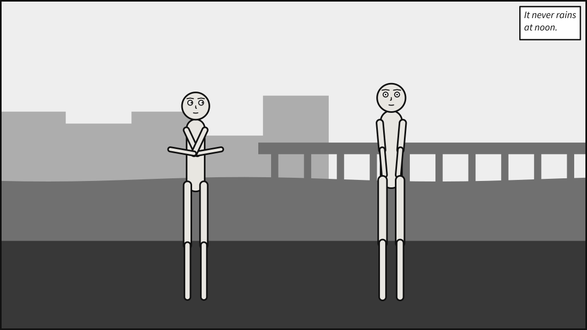
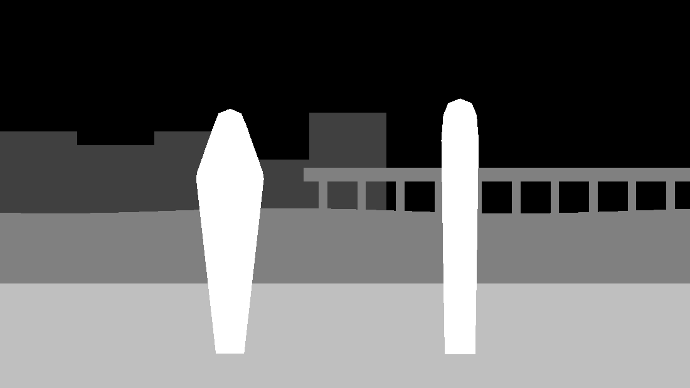
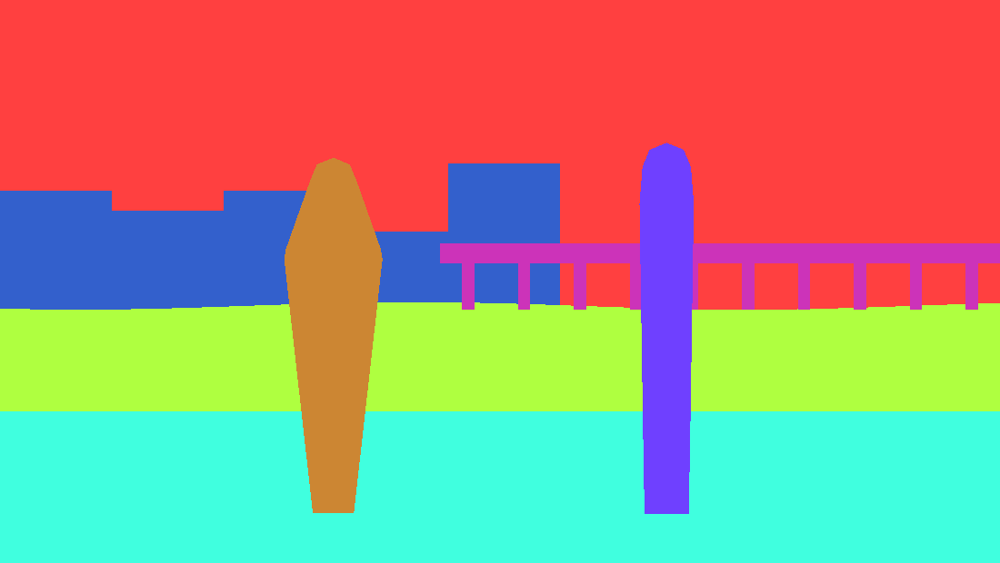

# Export a panel's staging for image models

Scenet resolves what image generators are worst at — who stands where, how big, facing which
way, at what shot — and draws it as a mannequin. When you would rather have a model paint the
panel, hand it that staging in the formats spatially conditioned models already read: a pose, a
box per figure, a depth map, a mask, and the structure of the scene.

**No model runs in Scenet.** Each export is one more emitter, reading [Panel
Core](../reference/panel_core.md) and nothing else, as deterministic and as explicable as the
SVG. Whatever you feed it to afterwards is outside the pipeline, the way an artist tracing over
the SVG is. Nothing is rasterised either: the exports are text, JSON and SVG, and turn into
pictures with whatever you already use for SVG.

## Build them

```bash
scenet build duel.panel.yaml --conditioning
```

Five files land beside `duel.svg`:

| File | What it is | Read by |
|---|---|---|
| `duel.pose.json` | Each actor's skeleton, [OpenPose](https://github.com/CMU-Perceptual-Computing-Lab/openpose/blob/master/doc/02_output.md) COCO-18 | ControlNet's OpenPose tooling: ComfyUI's `POSE_KEYPOINT`, the WebUI pose editor |
| `duel.boxes.json` | A phrase and a box per figure | GLIGEN, and box-conditioned models after it |
| `duel.depth.svg` | Stepped grey planes, white near, black far | ControlNet depth, once rasterised |
| `duel.mask.svg` | Each figure and backdrop mass in its own flat colour | Regional prompting, inpainting per figure |
| `duel.semantics.json` | Camera, setting, cast and lettering, as structure | Whatever writes your prompt |

A scene or a comic script gets one set per panel, named after each panel's SVG. From Python:

```python
from scenet import compile_source, render_conditioning

core = compile_source("""
camera: {shot: full_shot}
cast:
  alice: {reference: alice, pose: pointing}
  bob: {reference: bob, facing: left}
staging: [alice left_of bob, alice looking_at bob]
""").core

exports = render_conditioning(core)
files = dict(exports.files())
assert list(files) == [".pose.json", ".boxes.json", ".depth.svg", ".mask.svg", ".semantics.json"]
```

The [MCP server](../reference/mcp.md)'s `render` takes `conditioning: true` and returns the same
five per panel; the [playground](https://creatoan.github.io/scenet/playground/) offers them for a
one-panel document in its Download menu.







## The pose

`people[]` holds one person per actor, in Panel Core's order, each 18 `x, y, confidence`
triplets in COCO-18 order (nose, neck, right shoulder, elbow, wrist, left shoulder, elbow,
wrist, right hip, knee, ankle, left hip, knee, ankle, right eye, left eye, right ear, left
ear) in pixels of a canvas `canvas_width` by `canvas_height`: the panel at one pixel per unit,
rounded up. A tool that wants fractions instead divides by the canvas size.

**Left and right are the subject's.** Every Scenet body faces the reader, turned one way or the
other, and a body facing you has its right hand on your left. Scenet's own joint names are the
other way about — `shoulder_l` is the shoulder on the screen's left in the puppet's rest pose —
so the export maps them per facing:

| `facing` | OpenPose right | OpenPose left |
|---|---|---|
| `right` | `shoulder_l`, `elbow_l`, `wrist_l`, `hip_l`, … `eye_l` | the `_r` joints |
| `left` (mirrored) | the `_r` joints | the `_l` joints |

Either way the subject's right shoulder is on the reader's left, so a model is never handed a
figure turned away from you.

A point is `0, 0, 0` — as OpenPose writes a part it did not detect — when it is outside what the
panel draws (its frame, or a slanted tier's outline: a medium shot has no knees), when the
puppet has no joint by that name, and always for the ears, which no puppet draws. `root`,
`spine` and `head` have no COCO-18 counterpart. Figures a picture draws were never posed and are
not in `people`.

## The boxes

```python
import json

from scenet import compile_source, render_conditioning

core = compile_source("""
camera: {shot: full_shot}
cast:
  alice: {reference: alice, pose: pointing, expression: angry}
  bob: {reference: bob, facing: left}
staging: [alice left_of bob]
""").core

boxes = json.loads(render_conditioning(core).boxes)["boxes"]
phrases = [box["phrase"] for box in boxes]
locations = [box["box"] for box in boxes]
assert phrases == ["Alice, pointing, angry", "Bob"]
assert all(0 <= value <= 1 for box in locations for value in box)
```

Each box is `[xmin, ymin, xmax, ymax]` as fractions of the panel — `phrases` and `locations` are
what diffusers' GLIGEN pipeline takes as `gligen_phrases` and `gligen_boxes`. An actor's box is
its hull's bounds, clipped to the panel; a figure a picture draws gets its body and face. The
phrase is the [description](make_accessible_output.md)'s own words for the figure, without where
it stands, which is the box's to say.

## Depth and masks

Scenet is flat and orthographic: it has a painter's order, not distances. So the depth map is
flat grey planes in that order, each depth present one even step paler than the one behind it,
the frontmost white. Black is nothing nearer than infinity: the paper, the sky, and a supplied
picture, whose content Scenet never saw. This runs the opposite way to Scenet's own backdrop
tones, where far planes are paler, because a depth map is read white near.

Both maps are drawn on the pose's canvas, one unit to a pixel, so every export is on one pixel
grid: a panel of part units, such as one on a page, is not stretched, and what lies past its
edge is black. Edges are crisp, so a rasteriser blends no two regions into a colour or grey that
belongs to neither.

The mask fills each region in its own colour under the id the panel's SVG gives it —
`actor-alice`, `mass-m0`, `figure-ana` — so the colour of each is read from the SVG itself. **A
character keeps its colour across panels, unless another character in the same panel has the same
hue, in which case the later id (in sorted order) takes the next free one.** The hue is one of 64,
from the id, so with four characters in a panel that happens about one time in ten: read the
colour from the SVG rather than assuming it. A figure a picture draws takes the colour of the part
it plays. Masses take paler, less saturated colours, which no character's can be. What each region is, a puppet or a kind of mass, is in the
semantics under the same id.

Both use the regions the solver used: an actor's hull, a mass's polygon, a figure's body and
face. Not the mannequin's limbs: the export says *where* a character is, and the pose says how it
stands. Marks and sound effects are drawn around a figure, not part of it, and are in neither;
the semantics lists them.

## The semantics, which is not a prompt

Prompt dialects differ per model and change every few months, so Scenet hands over structure and
leaves the prose to you: the shot and angle, the place, hour and weather, each actor's puppet,
pose, expression, marks, facing, whom they look at and their depth, every figure a picture draws,
and every balloon, caption and sound effect in reading order with its box — DiffSensei's dialog
boxes. The `description` and each entry's `label` are Panel Core's, the words accessible output
reads; nothing is phrased twice.

## Right to left, figures, pictures

- **A panel read right to left** exports the same pose, boxes, depth and mask as the panel read
  left to right: only reading follows `direction`, never the scene. The semantics says
  `direction`, names the cast from the right in its description, and has the lettering where it
  went.
- **Figures a picture draws** have boxes, mask regions, and one depth plane in front of their
  picture — nothing orders two of them — but no pose and no camera: the artist drew and framed
  them.
- **Over a supplied picture**, the picture is the far plane and the background of the mask. The
  semantics names the picture and says nothing of its place or hour, which are in it.

## A whole page

Each panel's Core is compiled at exactly its frame's size, so a panel's units are the page's,
shifted by where its frame is — and `--core` writes that as each page's Page Core. A page-level
layout, as DiffSensei takes one, is the frames plus each panel's boxes:

```python
import json

from scenet import compile_book, render_conditioning

book = compile_book("""
cast: {alice: {reference: alice}, bob: {reference: bob}}
panels:
  one: {staging: [alice left_of bob]}
  two: {camera: {shot: close_up}}
pages: [{tiers: [{panels: [one, two]}]}]
""")

page = book.pages[0]
layout = []
for frame in page.frames:
    core = book.panels[frame.panel].core
    for box in json.loads(render_conditioning(core).boxes)["boxes"]:
        xmin, ymin, xmax, ymax = box["box"]
        layout.append(
            {
                "panel": frame.panel,
                "id": box["id"],
                "box": [
                    frame.x + xmin * frame.width,
                    frame.y + ymin * frame.height,
                    frame.x + xmax * frame.width,
                    frame.y + ymax * frame.height,
                ],
            }
        )
assert {entry["panel"] for entry in layout} == {"one", "two"}
```

A slanted tier's frame has an `outline`, and an inset a `clearance`, both in page units.
