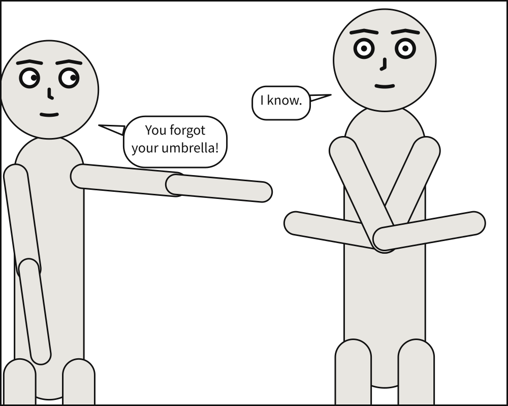

# Scenet

**A semantic DSL for comic panels, compiled to SVG.**

:::{admonition} This project is deliberately AI-generated
:class: warning

This project is, by design, almost entirely generated by AI. It exists as a personal
training ground for learning to work with AI coding tools. The architecture, code, tests
and documentation are overwhelmingly AI-authored, under human direction and review.

Treat it accordingly: an experiment first, a usable tool second.
:::

## What this is

Music has notation. A score describes the *semantics* of a piece — pitch, duration,
dynamics — without describing the waveform that eventually reaches your ear. Rendering is
left to an interpreter, human or machine.

Images have no such thing. SVG describes *how to draw*, not *what is depicted*: it is
closer to a WAV file than to a score. Scenet is an attempt at the missing layer, narrowed
to one tractable domain — the comic panel.

You write what is in the panel:

```yaml
panel:
  size: [1000, 800]

camera:
  shot: medium_shot

cast:
  alice: {reference: alice, pose: pointing,     at: left_third}
  bob:   {reference: bob,   pose: arms_crossed, at: right_third, facing: left}

staging:
  - alice left_of bob
  - alice looking_at bob
  - alice ground_shared_with bob

script:
  - say: {by: alice, text: "You forgot your umbrella!", prefer: top_left}
  - say: {by: bob,   text: "I know."}
```

And this is what it compiles to — not an illustration of the idea, but the file
`scenet build` writes for that document:



From that, the compiler works out the rest: how large each figure must be for a medium
shot, where they stand, which way they face, how big each balloon needs to be for its
text, where a balloon can sit without covering a face, and how its tail reaches the
speaker's mouth — all while preserving reading order.

**No generative image model is involved.** This is a deterministic compiler: constraint
solving and computational geometry. The same input always produces byte-identical output.

## Try it without installing anything

```{button-link} https://creatoan.github.io/scenet/playground/#src=XZBBboQwDEX3OYXLmlZ0V3GDHqGqqsiAgWgAI8doSivuXoeMqmmziv39X_yz4kJT7QBi-KIa3p-rqirhpao-nGtxJsFTHFlrmKkL2-xTkcSoScIptGb8FupJaEn3s1XCytGKlcOiYRlKSAcNM1GvXscg3WH-hpvahHu_tdJ09qPM0bfCMVJXnn4Jw3gDlNBja_AMPZyLikOqDfyY98jPcZ-o913miw161H_CILwtnYVEoc5fg47ngIuthFUzOOJuiZv9N6rSpy1WvPEGPcvACjtvAtvcCE0TPhT2G2fAGpRXn5f9S7qFvpFe4bLw9ak43A8
:color: primary
:shadow:

Open this panel in the playground, and change it
```

The [playground](https://creatoan.github.io/scenet/playground/) runs this compiler — the
same Python, unmodified — in your browser under WebAssembly via Pyodide. It is not a
reimplementation: the page installs the exact wheel `uv build` produces, so there is no
second copy of the geometry to drift out of step. Edit the document on the left and the
panel on the right follows as you type, with every finding underlined where it applies.

## Thirty seconds

```python
from scenet import compile_source, render

result = compile_source("""
panel:
  size: [800, 600]
cast:
  alice: {reference: alice}
script:
  - say: {by: alice, text: "Hello."}
""")

svg = render(result.core)
assert svg.lstrip().startswith("<?xml")
assert len(result.core.balloons) == 1
```

Every Python example in this documentation is executed by the test suite. If one of them
were missing an import, or had drifted out of step with the code, the build would fail.

## Where to go

These four sections follow [Diátaxis](https://diataxis.fr/): a tutorial to learn by doing, how-to
guides to get a job done, reference to look something up, and explanation to understand why. If you
are adding a page, that is how to decide where it belongs.

::::{grid} 1 1 2 2
:gutter: 3

:::{grid-item-card} Tutorial
:link: tutorial/index
:link-type: doc

Start here. Build one panel from nothing, understand each piece as it appears.
:::

:::{grid-item-card} How-to guides
:link: howto/index
:link-type: doc

Recipes for specific jobs: a sequence, a comic script, your own characters, embedding
the compiler in your own tool.
:::

:::{grid-item-card} Reference
:link: reference/index
:link-type: doc

The complete API, the language specification, the command line, and the normative
tables.
:::

:::{grid-item-card} Explanation
:link: explanation/index
:link-type: doc

Why the design is the way it is, what prior work it draws on, and what was deliberately
rejected.
:::
::::

## License

**0BSD** — deliberately one step more permissive than MIT. You may use, copy, modify and
distribute this software for any purpose, with no obligation to preserve a copyright
notice or reproduce the license. No attribution is required, though it is always welcome.

**The language specification is free to implement.** Anyone may build their own compiler,
editor, renderer or tooling for this language, in any project, commercial or otherwise,
without restriction. A notation is only worth having if it is not owned.

```{toctree}
:hidden:
:maxdepth: 2

tutorial/index
howto/index
reference/index
explanation/index
maintainer/index
```
