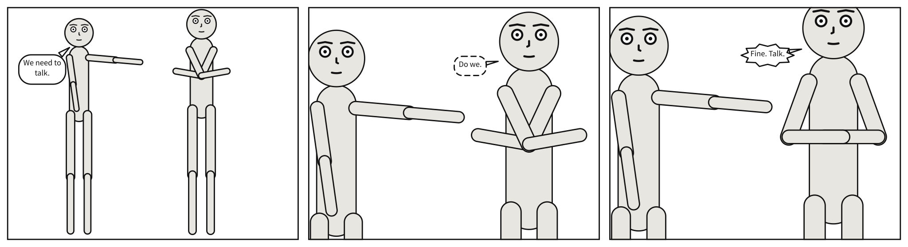

# Scene documents

A `.scene.yaml` holds several panels. Each is written under `panels:`, by a name, with the keys a
`.panel.yaml` takes; and anything written beside `panels:` is a default every panel inherits. A
panel may also be written `over` another, and state only what differs from it. A scene may then lay
its panels out on [pages](page.md#page-and-pages).



What a panel is, then, is three layers, each over the one before: the scene's defaults, the panel it
is `over` (and that panel's own parent, as far as the chain goes), and the panel's own keys. A chain
that names a panel that does not exist, or comes back to where it started, is `composition`.

## How a panel inherits

Two rules, and they are worth knowing precisely, with a third that takes something away:

- **Mappings merge recursively.** Overriding one actor's pose leaves the rest of that actor, and
  every other actor, alone: `cast: {alice: {pose: arms_crossed}}` keeps Alice's `reference` and
  `at`.
- **Lists replace wholesale.** Give a panel its own `staging:` and you replace the parent's entirely
  -- there is no appending. A list has no keys to merge on, and guessing at identity by position
  would be worse than a clear rule. So `marks: []` clears the marks a member inherited.
- **`null` leaves something out**; see [below](#null-leaves-something-out).

Some keys do not follow the rules. A [`description`](description.md#description) says what one
picture shows, so it is never a default and never inherited: beside `panels:` it is `unknown-key`,
and a panel drawn `over` another writes its own or has one generated. A
[`script`](script.md#script) is what one panel says, so it is no default either: beside `panels:` it
is `unknown-key`, and is written on the panel that says it, or on one the others are drawn `over`.
[`direction`](direction.md#direction) is only ever the document's: on a panel it is
`panel-direction`, since a sequence is read one way throughout. And the
[document's own keys](document.md) -- `scenet`, `$schema`, `meta`, `kind` -- are the scene's, never a
default: on a panel under `panels:` each is `unknown-key`.

## `null` leaves something out

A `null` removes what a panel would have inherited, as JSON Merge Patch
([RFC 7396](https://www.rfc-editor.org/rfc/rfc7396.html)) has it -- "If the value is null, remove". It
reaches whatever lies beneath, the panel it is `over` and the scene's defaults alike, at any depth
reached through mappings: `camera: null`, `cast: {bob: null}`, `setting: {place: null}`.

A cast member who goes takes every staging relation that names them along, since none can hold in a
panel they are not in, and `scenet check` notes each one as `dropped-relation`. All but one, while
the member left out is heard from off panel: `bob looking_at carol` still holds when Carol speaks
`off_panel` in that panel. A `null` inside a list is left as it is: a list is replaced whole, never
merged into.

The rule is the same in a single panel, which inherits nothing: there a `null` is a key not
written, so `camera: null` is the default camera, as `camera:` with no value is. The JSON Schema
says so too. A key the mapping does not have stays unknown whatever its value: `colour: null` is
`unknown-key`, as `colour: red` is.

```{scenet-example}
cast:
  alice: {reference: alice, at: left_third}
  bob: {reference: bob, at: right_third}
staging: [alice left_of bob]
panels:
  both: {}
  alone:
    cast: {bob: null}
```

## `panels`

<!-- facts: panels -->
The panels, in the order they are read: a mapping of each panel under its name, an identifier, or a list of panels each with its `name`, which no tool that sorts keys can reorder. Each may inherit from another with `over`.

| | |
|---|---|
| Where | A `.scene.yaml`. In a comic script: the script's `PANEL` headings |
| Type | anything |
| Default | none |
| Since | 0.1 |
| Diagnostics | [`invalid-field`](../diagnostics.md#invalid-field), [`invalid-identifier`](../diagnostics.md#invalid-identifier), [`duplicate-key`](../diagnostics.md#duplicate-key), [`composition`](../diagnostics.md#composition) |
<!-- /facts -->

The panels, in reading order. **The order they are written in is normative**: it is the order a
strip draws them and a screen reader reads them, unless pages lay them out, and it is part of the
document as much as any key. A name is text, as an actor id is, and is written once: two panels of
one name are `duplicate-key`. Everything a `.panel.yaml` takes may be written under each, and
`over` besides.

```{scenet-example}
panel: {size: [700, 500]}
cast: {alice: {reference: alice}}
panels:
  first: {camera: {shot: full_shot}}
  second: {camera: {shot: close_up}}
```

A tool that sorts keys -- PyYAML's `dump` does unless told not to, and `json.dumps` with
`sort_keys` -- reorders a mapping, and with it the comic, without a word. So the panels may also be
written as a list, each saying its [`id`](#panelsid), its name, in an order no tool reorders:

```{scenet-example}
panel: {size: [700, 500]}
cast: [{id: alice, reference: alice}]
panels:
  - id: first
    camera: {shot: full_shot}
  - id: second
    over: first
    camera: {shot: close_up}
```

The two forms are one language. A list is read as the mapping it stands for before anything else
happens to it -- before `over:` is resolved and a scene's defaults are merged -- so the two build
the same panels, and a scene may write its panels as a list and a cast as a mapping. Each key is one
form or the other: an item written as a mapping's entry, `- second: {...}`, is `missing-field`,
with the item as it should be.

## `panels[].id`

<!-- facts: panels[].id -->
The panel's name, in the list form of `panels`: an identifier, which a page and an `over` name it by.

| | |
|---|---|
| Where | A `.scene.yaml`. Not in a comic script |
| Type | text |
| Default | none |
| Since | 0.14 |
| Diagnostics | [`invalid-field`](../diagnostics.md#invalid-field), [`invalid-identifier`](../diagnostics.md#invalid-identifier), [`duplicate-key`](../diagnostics.md#duplicate-key), [`composition`](../diagnostics.md#composition) |
<!-- /facts -->

In the list form of `panels`, the name each panel gives itself, which the mapping form writes as
its key: what a page, an `over:` and every file the panel is written to name it by. It is written
`id`, as a cast member's is, so both lists name their items alike. It is an
[identifier](identifiers.md), and text: `id: 1` is `invalid-identifier`, quoted `id: '1'`. Two
panels of one id are `duplicate-key`, at the second, which names the item of the first.

```{scenet-example}
cast: [{id: alice, reference: alice}]
panels:
  - id: one
  - id: two
pages: [{tiers: [{panels: [one, two]}]}]
```

**See also:** [`cast[].id`](cast.md#castid), [`pages`](page.md#pages).

**See also:** [`pages`](page.md#pages), [Compile a sequence](../../howto/compile_a_sequence.md).

## `over`

<!-- facts: over -->
Name of a panel to inherit from. Only the differences need stating: mappings merge recursively and lists replace.

| | |
|---|---|
| Where | A panel under `panels:`. In a comic script: `@over:` in a panel |
| Type | text |
| Default | none |
| Since | 0.1 |
| Diagnostics | [`invalid-field`](../diagnostics.md#invalid-field), [`composition`](../diagnostics.md#composition) |
| In the gallery | [A sequence](../../gallery.md#a-sequence) |
<!-- /facts -->

The keyword is borrowed from [OpenUSD's composition arcs](../../explanation/prior_art.md), where
`over` means exactly this: name a parent, then state the difference. A comic script writes it as an
`@over:` directive. The parent need not be earlier in the document, nor on a page: a panel may
exist only to be inherited from.

```{scenet-example}
panels:
  establishing:
    camera: {shot: full_shot}
    cast:
      alice: {reference: alice, at: left_third}
      bob: {reference: bob, at: right_third, facing: left}
    staging: [alice left_of bob]
  reaction:
    over: establishing
    camera: {shot: close_up}
```

**See also:** [How a panel inherits](#how-a-panel-inherits),
[One panel over another](../../howto/write_a_comic_script.md#one-panel-over-another).
